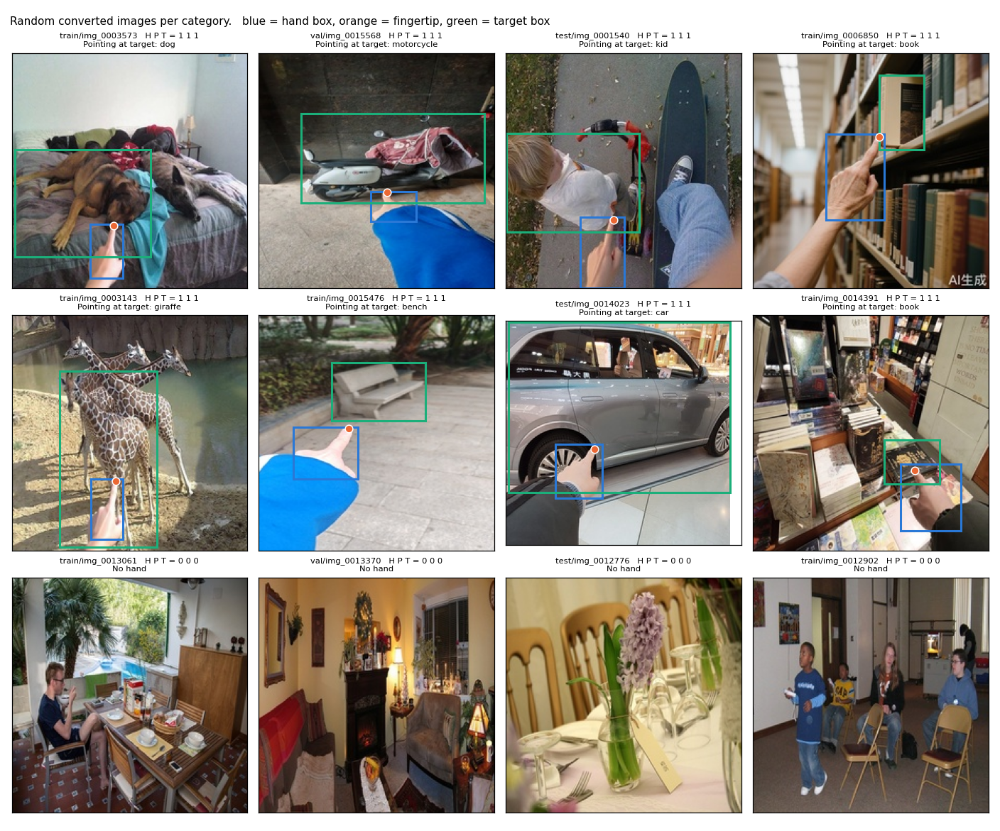
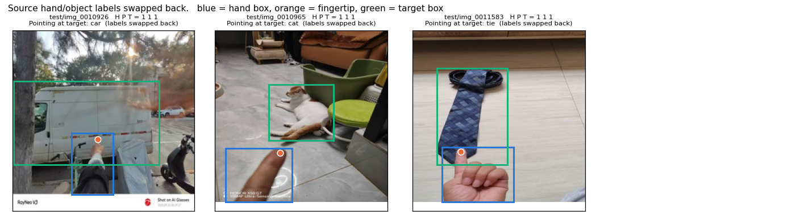

# EgoPoint for SpatialNet

EgoPoint converted to the SpatialNet label format (`annotation_format.md`) by `egopoint_preprocessing/prepare_egopoint.py`. The official train / val / test split is kept unchanged. Images are resized to 224 x 224 (JPEG quality 95); labels are normalised, so they do not depend on image size.

## Layout

```text
EgoPoint_spatialnet/
  train/ val/ test/
    images/  <name>.jpg
    labels/  <name>.txt   (H P T, hand box, fingertip, target box)
  manifest.csv   one row per image: source fields and conversion notes
  stats.json     every number in this file
  README.md
```

## Images per split and scene

| Split | Images | No hand | Non-pointing | Pointing, no target | Pointing at target |
|---|---:|---:|---:|---:|---:|
| train | 10669 | 1535 | 0 | 0 | 9134 |
| val | 1524 | 211 | 0 | 0 | 1313 |
| test | 3029 | 425 | 0 | 0 | 2604 |
| total | 15222 | 2171 | 0 | 0 | 13051 |

EgoPoint has no "Non-pointing" (hand visible, not pointing) and no "Pointing, no target" images: every positive image shows a pointing hand with one target.

## Pointing-at-target images by fingertip-target gap

Gap = distance from the fingertip to the target box, as a fraction of image size (on-object = touching, near <= 0.08, far > 0.08).

| Split | On-object | Near | Far | Median gap |
|---|---:|---:|---:|---:|
| train | 6511 | 1995 | 628 | 0.000 |
| val | 922 | 297 | 94 | 0.000 |
| test | 1796 | 599 | 209 | 0.000 |

## Box sizes (fraction of image area)

| Split | Hand p10 / median / p90 | Target p10 / median / p90 |
|---|---:|---:|
| train | 0.035 / 0.093 / 0.222 | 0.027 / 0.136 / 0.473 |
| val | 0.033 / 0.092 / 0.230 | 0.028 / 0.139 / 0.451 |
| test | 0.036 / 0.092 / 0.220 | 0.026 / 0.141 / 0.444 |

## Source properties

| Split | clear_or_not true / false / missing (positives) | Original landscape / square / portrait | Target categories |
|---|---:|---:|---:|
| train | 6960 / 1678 / 496 | 6345 / 2359 / 1965 | 312 |
| val | 996 / 250 / 67 | 910 / 325 / 289 | 171 |
| test | 1876 / 605 / 123 | 1808 / 677 / 544 | 209 |

`clear_or_not` is kept from the source in `manifest.csv`; spot checks show correct labels for both values, so it is not used to filter.

**Most frequent target categories (train):** person (1860), motorcycle (277), chair (238), cup (188), zebra (161), bicycle (153), car (151), book (150), doll (149), cake (145), elephant (144), bottle (139), giraffe (137), potted plant (133), suitcase (129).

## Conversion rules

| EgoPoint record | Result |
|---|---|
| `sample_type` negative (no hand; its COCO object boxes are ignored) | `0 0 0` |
| `sample_type` positive: `anno_hand` box + annotated `fingertip` + one target box | `1 1 1` |
| `anno_hand` label on an object and the real hand labelled as an object (detected by the fingertip) | labels swapped back, then `1 1 1` |
| positive without an annotated `fingertip` (all flagged `clear_or_not = false`; spot checks show open palms, held objects, or the hand box on the non-pointing hand) | dropped |
| positive without an `anno_hand` box, or without a target box | dropped |

- Source boxes are pixel `x1, y1, x2, y2`; they are clipped to the image and stored as normalised `cx cy w h`.
- Fingertips are normalised and clamped to [0, 1].
- Images are squashed to a square, as the model does at its 160 x 160 input; normalised labels are unaffected.

## Dropped records

| Reason | Train | Val | Test | Total |
|---|---:|---:|---:|---:|
| positive without an annotated fingertip | 164 | 22 | 43 | 229 |
| positive without a hand box | 3 | 0 | 0 | 3 |

Every dropped file name is listed in `stats.json`. Images without a JSON file are not converted (1 found).

## Visual check of the converted labels

Labels redrawn from the converted `labels/*.txt` onto the converted 224 x 224 images, so these show exactly what training reads.



The test images whose hand and object labels were swapped in the source, after the fix:



## Statistics per category

Only 2 of the 4 categories occur in the converted dataset: **No hand** (0 0 0), **Pointing at target** (1 1 1). Non-pointing and Pointing, no target have no images.

| Category | H P T | Train | Val | Test | Total | Share |
|---|---|---:|---:|---:|---:|---:|
| No hand | 0 0 0 | 1535 | 211 | 425 | 2171 | 14.3% |
| Non-pointing | 1 0 0 | 0 | 0 | 0 | 0 | 0.0% |
| Pointing, no target | 1 1 0 | 0 | 0 | 0 | 0 | 0.0% |
| Pointing at target | 1 1 1 | 9134 | 1313 | 2604 | 13051 | 85.7% |

### No hand (0 0 0)

| Property (p10 / median / p90) | Value |
|---|---:|
| Original width px | 480 / 640 / 640 |
| Original height px | 401 / 480 / 640 |

### Pointing at target (1 1 1)

| Property (p10 / median / p90) | Value |
|---|---:|
| Original width px | 500 / 640 / 1023 |
| Original height px | 427 / 767 / 1023 |
| Hand box area (fraction of image) | 0.035 / 0.093 / 0.222 |
| Hand centre y (0 = top, 1 = bottom) | 0.563 / 0.759 / 0.859 |
| Fingertip y | 0.380 / 0.594 / 0.748 |
| Target box area (fraction of image) | 0.027 / 0.138 / 0.465 |
| Fingertip-target gap | 0.000 / 0.000 / 0.058 |
| Gap on-object / near / far (images) | 9229 / 2891 / 931 |
| clear_or_not true / false / missing (images) | 9832 / 2533 / 686 |
| Distinct target categories | 349 |
| Most frequent targets | person (2623), motorcycle (405), chair (323), cup (269), zebra (230), car (222), book (214), doll (212), elephant (208), cake (205) |
